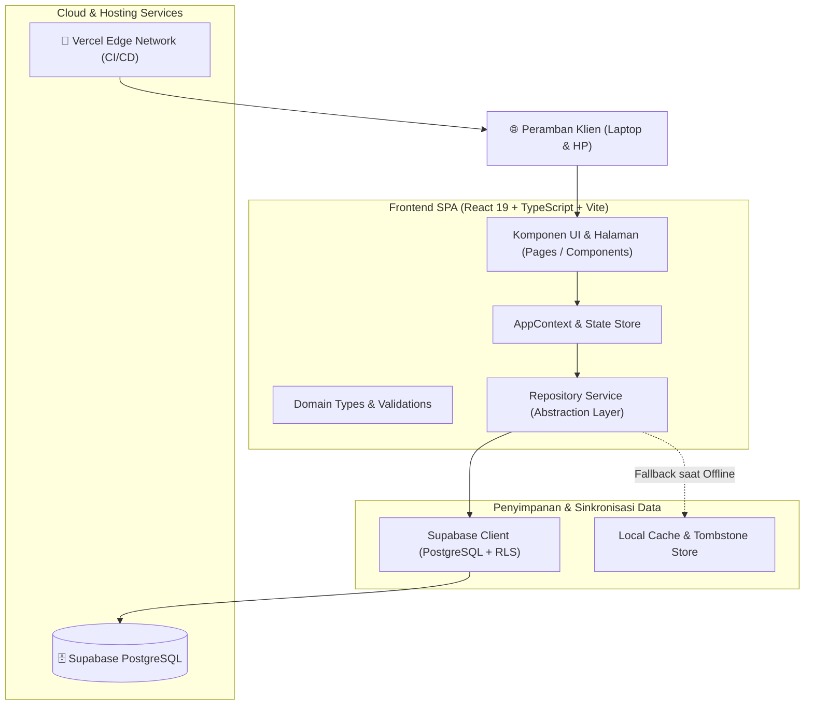

# 🏗️ ARCHITECTURE.md — TimeCraft Technical Architecture

Dokumen ini mendefinisikan arsitektur sistem, tumpukan teknologi (*technology stack*), alur kerja (*system workflows*), dan skema basis data dari platform **TimeCraft**.

---

## 1. Ikhtisar Arsitektur (*High-Level Architecture*)

TimeCraft menerapkan arsitektur **Single Page Application (SPA)** modern dengan pola **Repository Pattern** terabstraksi yang menghubungkan antarmuka pengguna ke basis data cloud terdistribusi (Supabase PostgreSQL) serta didukung penyimpanan cadangan lokal (*resilient offline fallback*).



---

## 2. Tumpukan Teknologi (*Technology Stack*)

| Lapisan (*Layer*) | Teknologi | Versi | Alasan Pemilihan & Keunggulan |
| :--- | :--- | :--- | :--- |
| **Frontend Framework** | React | `^19.0.0` | Paradigma komponen modern, rendering performa tinggi, dan ekosistem hook tangguh. |
| **Bahasa Pemrograman** | TypeScript | `~5.7.2` | Tipe data ketat (*strict type-safety*), meminimalkan runtime error, dan dokumentasi diri (*self-documenting*). |
| **Build Tool & Bundler** | Vite | `^6.2.0` | Kompilasi ultra-cepat berbasis ESM native, Hot Module Replacement (HMR) instan, dan optimasi chunk bundle. |
| **Styling Engine** | Vanilla CSS Modern | CSS3 Native | Kontrol penuh atas variabel tema (Dark/Light), nol beban kompilasi runtime (*zero runtime overhead*), dan performa cetak presisi. |
| **Ikonografi** | Lucide React | `^1.16.0` | Ikon vektor ringan, konsisten, dan mudah disesuaikan. |
| **Cloud Database & Auth** | Supabase (PostgreSQL) | `^2.49.1` | Basis data relasional standar industri, Row Level Security (RLS), dan sinkronisasi instan multi-perangkat. |
| **Unit Testing** | Vitest | `^3.2.4` | Runner pengujian kompatibel Vite, cepat, untuk validasi logika kalkulasi waktu dan integritas data. |
| **Hosting & CI/CD** | Vercel | Production | Jaringan edge global, sertifikat SSL otomatis, dan deployment instan berbasis Git push. |

---

## 3. Pola Arsitektur Data (*Repository Pattern*)

Semua interaksi data diisolasi melalui modul `src/services/repository.ts`. Komponen antarmuka pengguna tidak pernah memanggil API basis data secara langsung, melainkan melalui fungsi repository yang seragam.

### Fitur Utama Lapisan Repository:
1. **Ketahanan Offline / Fallback Resilient**:
   Jika jaringan internet mengalami gangguan atau kunci Supabase belum terkonfigurasi, repository secara mulus beralih ke *Local Storage* tanpa membuat aplikasi mogok (*graceful degradation*).
2. **Pola Tombstone Deletion (*Anti-Resurrection*)**:
   Ketika ruang kelas atau ruang keluarga dihapus oleh pengguna, ID ruangan dicatat dalam daftar *tombstone*. Hal ini mencegah data yang sudah dihapus muncul kembali saat sinkronisasi asinkron berlangsung.
3. **Kompatibilitas Ganda Ruang Keluarga (*Dual-Table Fallback*)**:
   Untuk menjamin ruang keluarga dapat dibuat dan diakses secara serempak antar-perangkat (misal laptop orang tua dan HP anak), sistem mendukung tabel resmi `family_groups` dengan fallback cerdas ke entitas bertag `[FAMILY_PORTAL]` pada tabel `classrooms`.

---

## 4. Skema Basis Data (*Database Schema*)

TimeCraft menggunakan PostgreSQL terkelola oleh Supabase dengan aturan keamanan tingkat baris (*Row Level Security / RLS*):

### 4.1 Tabel `profiles`
Menyimpan identitas dasar pengguna yang terhubung ke Supabase Auth:
```sql
CREATE TABLE public.profiles (
  id UUID PRIMARY KEY REFERENCES auth.users(id) ON DELETE CASCADE,
  email TEXT NOT NULL,
  display_name TEXT NOT NULL,
  avatar_url TEXT,
  timezone TEXT DEFAULT 'Asia/Jakarta',
  created_at TIMESTAMPTZ DEFAULT NOW(),
  updated_at TIMESTAMPTZ DEFAULT NOW()
);
```

### 4.2 Tabel `screen_time_logs`
Menyimpan catatan waktu layar per sesi harian:
```sql
CREATE TABLE public.screen_time_logs (
  id UUID PRIMARY KEY DEFAULT gen_random_uuid(),
  user_id UUID NOT NULL REFERENCES public.profiles(id) ON DELETE CASCADE,
  activity_date DATE NOT NULL,
  start_time TIME NOT NULL,
  end_time TIME NOT NULL,
  duration_minutes INTEGER NOT NULL,
  category TEXT NOT NULL,
  notes TEXT,
  created_at TIMESTAMPTZ DEFAULT NOW()
);
```

### 4.3 Tabel `focus_sessions`
Menyimpan riwayat sesi Pomodoro / Focus Timer:
```sql
CREATE TABLE public.focus_sessions (
  id UUID PRIMARY KEY DEFAULT gen_random_uuid(),
  user_id UUID NOT NULL REFERENCES public.profiles(id) ON DELETE CASCADE,
  session_date DATE NOT NULL,
  planned_duration_minutes INTEGER NOT NULL,
  actual_focus_seconds INTEGER NOT NULL,
  status TEXT NOT NULL, /* 'completed' | 'cancelled' */
  task_label TEXT,
  created_at TIMESTAMPTZ DEFAULT NOW()
);
```

### 4.4 Tabel `classrooms` & `classroom_members`
Memfasilitasi pemantauan murid oleh guru melalui kode kelas unik:
```sql
CREATE TABLE public.classrooms (
  id UUID PRIMARY KEY DEFAULT gen_random_uuid(),
  teacher_id UUID NOT NULL REFERENCES public.profiles(id) ON DELETE CASCADE,
  class_name TEXT NOT NULL,
  class_code TEXT NOT NULL UNIQUE,
  description TEXT,
  created_at TIMESTAMPTZ DEFAULT NOW()
);

CREATE TABLE public.classroom_members (
  id UUID PRIMARY KEY DEFAULT gen_random_uuid(),
  classroom_id UUID NOT NULL REFERENCES public.classrooms(id) ON DELETE CASCADE,
  student_id UUID NOT NULL REFERENCES public.profiles(id) ON DELETE CASCADE,
  joined_at TIMESTAMPTZ DEFAULT NOW(),
  UNIQUE(classroom_id, student_id)
);
```

### 4.5 Tabel `family_groups` & `family_members`
Memfasilitasi pemantauan anak oleh orang tua melalui kode keluarga unik:
```sql
CREATE TABLE public.family_groups (
  id UUID PRIMARY KEY DEFAULT gen_random_uuid(),
  parent_id UUID NOT NULL REFERENCES public.profiles(id) ON DELETE CASCADE,
  family_name TEXT NOT NULL,
  family_code TEXT NOT NULL UNIQUE,
  description TEXT,
  created_at TIMESTAMPTZ DEFAULT NOW()
);

CREATE TABLE public.family_members (
  id UUID PRIMARY KEY DEFAULT gen_random_uuid(),
  family_id UUID NOT NULL REFERENCES public.family_groups(id) ON DELETE CASCADE,
  child_id UUID NOT NULL REFERENCES public.profiles(id) ON DELETE CASCADE,
  joined_at TIMESTAMPTZ DEFAULT NOW(),
  UNIQUE(family_id, child_id)
);
```

---

## 5. Subsistem Teknis Kritis

### 5.1 Mesin Pencegah Tabrakan Waktu (*Anti-Collision Engine*)
Diimplementasikan pada `src/utils/time.ts` (`checkTimeCollision`):
* Setiap input waktu layar diverifikasi terhadap seluruh catatan pada tanggal yang sama.
* Rumus deteksi tumpang tindih: `startA < endB && endA > startB`.
* Menolak penyimpanan aktivitas yang saling tabrak demi integritas data laporan.

### 5.2 Pengatur Fokus Berbasis Stempel Waktu (*Timestamp Delta Engine*)
* Tidak mengandalkan `setInterval` sederhana yang mudah meleset saat peramban di-*throttle* di latar belakang.
* Menggunakan perhitungan selisih waktu riil: `elapsed = Math.floor((Date.now() - sessionStartTime) / 1000)`.
* Sesi tetap berjalan akurat bahkan jika tab ditutup atau perangkat dimuat ulang.

### 5.3 Mesin Ekspor PDF Eksekutif
* Menggunakan jendela cetak independen dengan kode HTML + CSS yang terisolasi dan *self-contained*.
* Menyematkan logo vektor SVG langsung ke dokumen (*zero external network assets*) agar dokumen langsung siap cetak 300 DPI tanpa penundaan unduhan aset.
